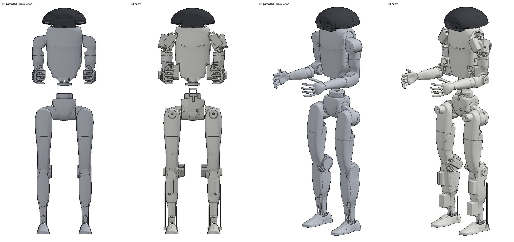
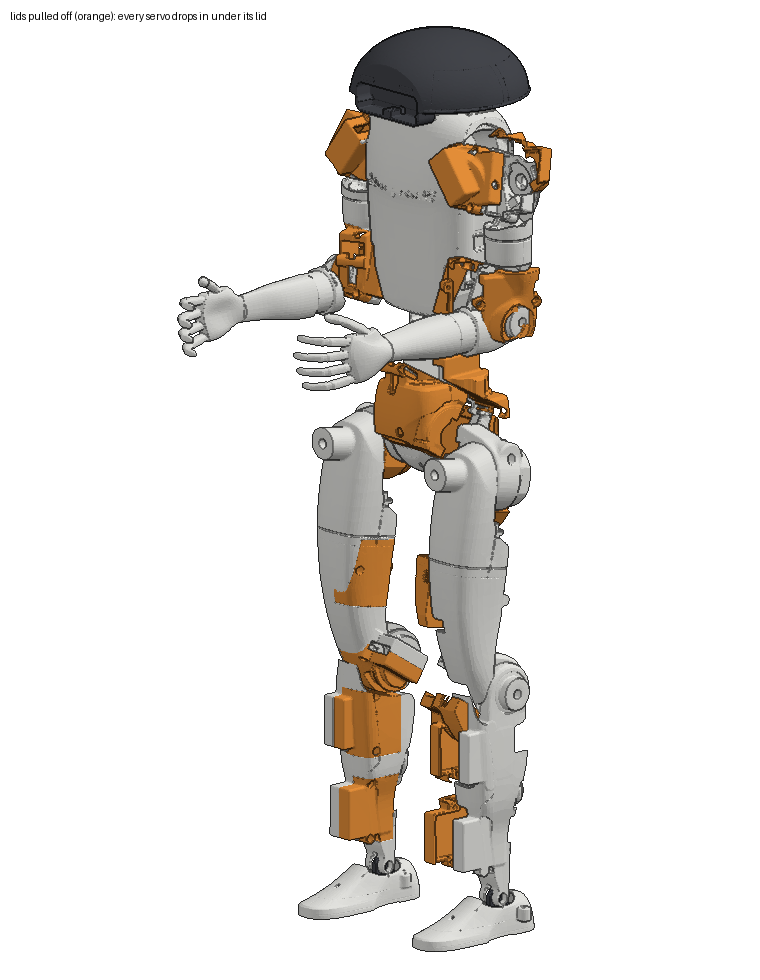
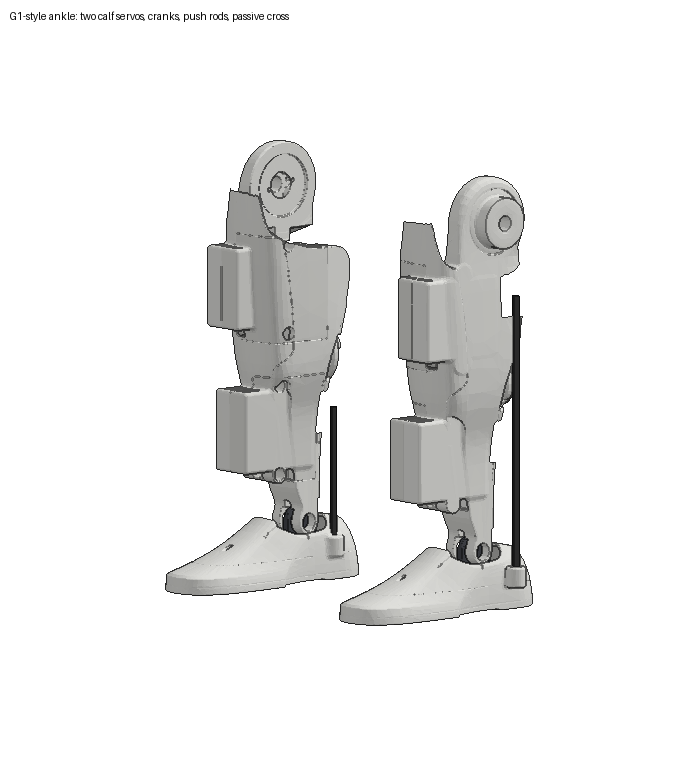

# G1 micro: the G1 parts, shrunk and edited for micro servos

These are **the Unitree G1 parts scaled to 0.35** (about 45 cm tall) with your **OpenG1 dome head** on top. Each part is edited only where a micro servo has to go in. No shapes are invented.

- **Source parts:** the official G1 meshes `g1_23dof_rev_1_0` from `unitree_ros`. They are the same shapes your OpenG1 links are cut from, but without the large-actuator cut-outs.
- **Head:** your `head/` frame and panels from the OpenG1 repo, as one solid dome. The torso top is cut out so it sits on it; glue it on. Your two brows are separate small parts (`head_brow_left/right`), as in your design.
- **Kinematics:** taken straight from the G1 URDF and scaled. Joint names, zero pose and signs are G1's, so G1 / G1_tele poses map one-to-one. The elbow's 0 is the G1 elbow's 0, which is a 90° bend.



## What was changed on the G1 parts (and nothing else)
1. **Servo pocket.** Each servo sits in a pocket inside the G1 part that holds it ("host"). Where the servo is bigger than the part at this scale, the part gets a **bulge just big enough to cover it**: a 1.2 mm wall around the case, blended into the G1 surface.
2. **Horn socket.** The servo's output axis is the G1 joint axis. The part on the other side of the joint gets a socket shaped like the cross horn (arms snipped to 13 mm tip-to-tip). It also gets a hole for the centre screw and two pilot holes for small horn screws. Where the G1 part had no material at the horn, a small boss is added.
3. **Clearance at the joints.** The G1 display meshes overlap each other at some joints (shoulder, knee), so they can't be printed as-is. Each driven part is trimmed where its neighbour sweeps past it through the joint range, near the joint only. The dome head has the torso top cut out so it sits on it.
4. **A lid over every servo.** The G1 shell is cut along the servo's middle plane. The lid comes off, the servo drops in, and the lid goes back on with 2 × M2 screws.
5. **Ankles work like the real G1's.** The G1 ankle is too small for servos, and the G1 doesn't put motors there either.
   - Two servos sit in the **calf** (upper and lower), each with a horn crank.
   - **Push rods** run down behind the calf to two studs on the **heel**: 86 mm outer, 41 mm inner, studs 8 mm behind the ankle axis.
   - The G1 ankle cross is **passive** on two M2 pins.
   - Both cranks turning the same way gives **pitch**; turning opposite ways gives **roll**.




## Where the servos are
| Joint (G1 name) | Servo lives in | Drives (horn socket in) | Range used (°) |
|---|---|---|---|
| hip_pitch | pelvis | hip_pitch_link | −130 … 90 |
| hip_roll | hip_pitch_link | hip_roll_link | −25 … 90 (left) |
| hip_yaw | hip_yaw_link (thigh) | hip_roll_link | −90 … 90 |
| knee | hip_yaw_link (thigh) | knee_link (calf) | −5 … 140 |
| ankle pitch + roll | 2 crank servos in knee_link (calf) | foot via push rods | −45 … 30 / ±15 |
| waist_yaw | pelvis | torso | −90 … 90 |
| shoulder_pitch | shoulder_pitch_link | torso | −175 … 120 |
| shoulder_roll | shoulder_pitch_link | shoulder_roll_link | −20 … 120 (left) |
| shoulder_yaw | shoulder_yaw_link | shoulder_roll_link | −120 … 120 |
| elbow | shoulder_yaw_link | elbow (forearm + hand) | −60 … 120 |

That's 21 servos. There are no wrist joints: the G1 wrist roll link and rubber hand are fused to the forearm.

**Where the bulges are.** These are the places the servo didn't fit inside the G1 part at 0.35:
- shoulder pitch link (two servos)
- the knee side of the thigh
- the calf (the two ankle servos sit only about 40 % inside the G1 calf)
- the waist, where the servo stands up out of the pelvis into the gap below the torso

Everything else is the plain G1 surface.

## Servos
Every pocket is the same 23 × 12 mm micro-servo size.
- **Feetech STS3032 (4.5 kg·cm):** all leg joints including the 4 ankle cranks, waist, and shoulder pitch (15 servos).
- **Feetech SCS0009 (2.3 kg·cm):** shoulder roll, shoulder yaw and elbow (6 servos).

The cheaper PWM alternative is MG92B / MG90S. Measure your servo against `SV` in `generator/design.py` first.

**Estimated mass is ~850 g**: ~410 g PLA, ~375 g servos, ~65 g electronics (`parts.md`). Hip-to-knee is 118 mm.

| Single-leg knee bend | Knee torque | Share of STS3032 stall |
|---|---|---|
| 10° | ~1.6 kg·cm | 35 % |
| 20° | ~3.2 kg·cm | ~70 % |

**Walk with the knees fairly straight.** Bent-knee walking will overheat the knee servos. I don't know of a stronger servo in the same 23 × 12 size.

Power: 2S LiPo through a 6 V buck converter (≥ 5 A). The G1 torso is hollow and has room for the controller and battery.

## Hardware
- 21 micro servos and their cross horns (arms snipped to 13 mm tip-to-tip)
- 42 × M2 × 8 (lids)
- 42 × M1.6/M2 × 4 self-tappers (horns into the sockets)
- 21 horn centre screws (they come with the servos)
- 4 × M2 rod: two 86 mm, two 41 mm
- 8 × M2 ball links
- 4 × M2 ball studs or M2 × 10 screws (heel)
- 4 × M2 × 12 (ankle cross pins)
- Foam pads under servos shorter than 31 mm

## Assembling a joint
1. Put the servo in its pocket and fit the lid (2 × M2 screws).
2. Screw the trimmed cross horn into the socket in the driven G1 part.
3. Push that part onto the spline at the joint's zero angle.
4. Fit the horn centre screw through the access hole in the driven part.
5. For an ankle: fit single-arm horns as cranks pointing sideways (outer servo outward, inner servo inward), run the rods with ball links to the heel studs, and pin the cross with the two M2 pins.

## Printing and moulding
- **Printing:** files in `STL/print/` are laid on their largest flat face (usually the lid split face). The outside is the curved G1 surface, so some parts need supports. **Print `STL/print/fit_test` before anything else.**
- **Moulding:** I dropped the strict "every shell straight-pull" rule from the previous version, because you asked for the exact G1 shape. Every body and lid has one flat split face, which makes silicone moulding practical. But the curved G1 outsides need two-part (sometimes three-part) silicone moulds, and I haven't checked them for undercuts. Glue faces are the flat lid faces.

## Files
```
STL/print/        every piece, flat face down: <link>_<body|lidN>.stl, left and right
STL/assembly/     every piece in robot coordinates (zero pose, mm)
g1_micro_assembly.scad   whole robot in OpenSCAD: one slider per G1 joint, show/hide lids
sim/g1_micro.xml  MuJoCo: Unitree's own G1 23-DoF model scaled to 0.35, wrists fixed,
                  micro masses, position actuators with servo torque limits
parts.md          pieces, volumes, estimated mass
report/           mesh checks, pose checks, link masses
renders/
generator/        g1.py (G1 meshes + URDF), place.py (servo placement), g1build.py (edits),
                  g1check.py, g1export.py, g1sim.py, g1render.py
```

## Regenerating
```
git clone https://github.com/unitreerobotics/unitree_ros      # G1 meshes + URDF (only robots/g1_description is needed)
export G1_DESCRIPTION=.../unitree_ros/robots/g1_description
export OPENG1_STL=.../humanoid/STL                              # your repo, for the dome head
cd generator
g++ -O3 -o voxelize voxelize.cpp; g++ -O3 -o dist dist.cpp; g++ -O3 -o decimate decimate.cpp; g++ -O3 -o raster raster.cpp
python place.py       # servo placement in the scaled G1 parts (placements.json is included)
python g1build.py     # edits every left/centre part (~25 min) -> g1_cache/
python g1export.py    # STLs, SCAD, parts.md, masses, sim, fit test
python g1check.py; python g1render.py
```
The scale is `S` in `g1build.py` / `place.py`. Servo dimensions, horn and clearances are in `design.py`.

## Checks run
- All pieces are watertight and in one piece (`report/mesh_check.json`).
- **Pose checks** (`report/pose_check.json`, G1 joint angles): every part against every other part. All 10 working poses are clear:
  - zero pose, arms down, squat, T-pose, arms up, arms forward, walking sway, a step, a waist + hip turn, and push-up arms
- **Two limits to know:**
  - **Arms straight down with no shoulder roll:** the hand hits the hip, exactly as on the **untouched** G1 parts. Use 8° or more of shoulder roll.
  - **Arms straight up:** this needs about 50° of shoulder roll to clear your wide dome head.

## Not yet verified
- **Nothing has been printed.**
- **The sim model has not been loaded in MuJoCo here.** It is Unitree's model with lengths, masses and actuators changed. It models the ankle as direct pitch/roll joints, the same way Unitree's own model treats the real G1's rod ankle.
- **Servo envelope:** the Feetech spline position is inferred from datasheets.
